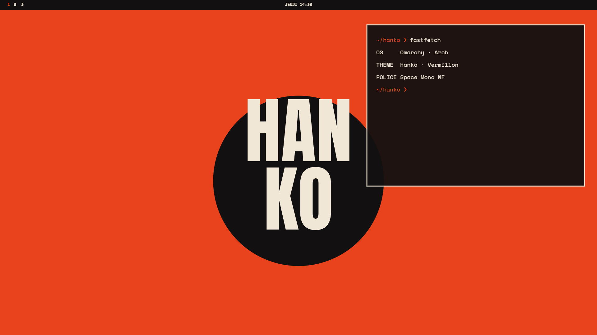

# Hanko · Vermillon — Omarchy theme

A minimal, editorial dark theme for [Omarchy](https://omarchy.org): near-black surfaces, cream type, one strong colour (Vermillon `#ff4a1c`), poster-style wallpapers set in Anton.



## Install
```
omarchy-theme-install https://github.com/MoozyDev/omarchy-hanko-vermillon-theme
```
Works on its own (palette, wallpapers, previews, icons). For everything — bar that grows on hover, wide menu, screensaver, lock screen — use the one-command installer from [omarchy-hanko-extras](https://github.com/MoozyDev/omarchy-hanko-extras):

```
curl -fsSL https://raw.githubusercontent.com/MoozyDev/omarchy-hanko-extras/main/install.sh | bash -s vermillon
```

## Contents
- `colors.toml` — full palette (`mode = "dark"`)
- `icons.theme` — `Yaru-red`
- `backgrounds/` — 01 to 05, 3840×2160; `backgrounds/vertical/` — the same in 2160×3840 for vertical screens (kept out of the background picker, which only lists the top folder)
- `webapps/`, `apps/` — 512 px icons (copy to `~/.local/share/applications/icons/`)
- `boot/` — Limine colour block, Plymouth colours
- `apps-themes/` — Spotify (Spicetify), Discord (Vesktop), Obsidian

## Fonts
Anton (display, OFL) · SpaceMono Nerd Font (`ttf-space-mono-nerd`).

---

**En français** — Variante Vermillon du thème Hanko : fond presque noir, texte crème, une seule couleur forte. Le dossier suffit seul ; les éléments à coder (barre, verrouillage, widgets, veille) sont dans le dépôt `extras`.
